# Informe de Evaluación Parcial AUY1102

## Análisis de calidad y seguridad de un pipeline

**Estudiante:** Claudio Garrido D.    
**Repositorio base:** [Fundacion-Instituto-Profesional-Duoc-UC/AUY1102-Pipeline](https://github.com/Fundacion-Instituto-Profesional-Duoc-UC/AUY1102-Pipeline)  
**Fork desarrollado:** [clgarridod-hue/AUY1102-Pipeline](https://github.com/clgarridod-hue/AUY1102-Pipeline)  
**Rama de trabajo:** `master`

---

## 1. Introducción

El objetivo de esta evaluación fue aplicar un proceso de revisión de calidad y seguridad sobre un proyecto Node.js. El trabajo se realizó de forma individual sobre un fork alojado en mi cuenta de GitHub.

Las actividades incluyeron la preparación del entorno, ejecución de pruebas unitarias, obtención de cobertura, análisis con SonarQube Cloud y Snyk, revisión con `npm audit`, configuración de funciones de seguridad en GitHub y corrección de un hallazgo verificable.

## 2. Herramientas utilizadas

- Git 2.54.0.
- GitHub.
- Visual Studio Code.
- NVM 0.41.0.
- Node.js v22.23.4.
- npm 10.9.9.
- Jest e Istanbul para pruebas y cobertura.
- SonarQube Cloud para análisis de calidad y seguridad.
- Snyk Open Source para análisis de dependencias.
- `npm audit` para revisión del árbol de dependencias.
- GitHub Dependency Graph, Dependabot y funciones de seguridad disponibles en el repositorio.

## 3. Preparación del repositorio

### 3.1 Creación del fork

Se creó un fork del repositorio institucional en la cuenta personal `clgarridod-hue`. Este mecanismo permitió trabajar sin modificar el repositorio original y mantener una copia independiente para la entrega.

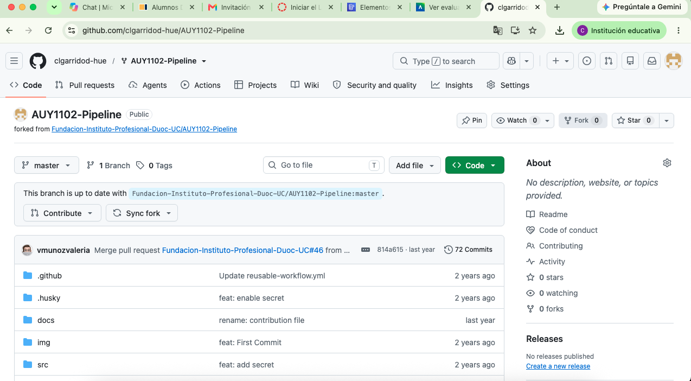

### 3.2 Clonación local

El fork fue clonado en el equipo local mediante HTTPS. La salida de Git confirmó la descarga completa de los objetos del repositorio.

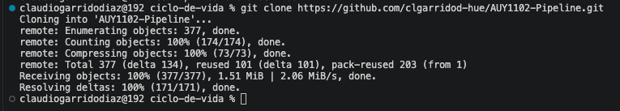

### 3.3 Verificación de remotos y rama

El proyecto se abrió en Visual Studio Code. Se verificó que `origin` apuntara al fork personal, que `upstream` apuntara al repositorio institucional y que la rama activa fuera `master`. Los cambios se enviaron exclusivamente a `origin`.

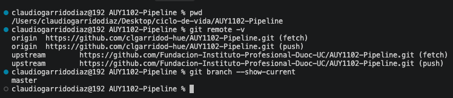

## 4. Preparación del entorno

### 4.1 Versiones instaladas

Se instaló NVM para administrar Node.js y se utilizó Node.js 22 LTS. Las versiones registradas fueron Git 2.54.0, NVM 0.41.0, Node.js v22.23.4 y npm 10.9.9.

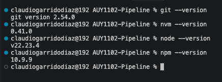

### 4.2 Revisión de la configuración del proyecto

El archivo `package.json` declaró compatibilidad con Node.js `>=14`, por lo que Node.js 22 cumplió el requisito. También se identificaron scripts para pruebas unitarias, cobertura, desarrollo, lint y compilación.

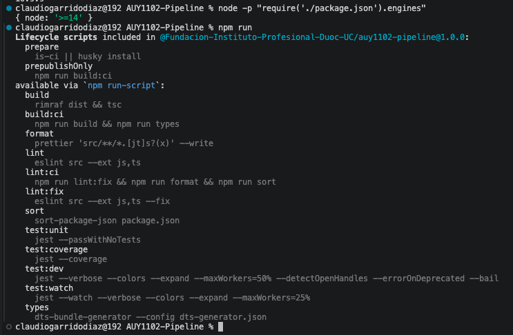

### 4.3 Instalación de dependencias

Como el repositorio incluía `package-lock.json`, se utilizó `npm ci` para efectuar una instalación reproducible. Se instalaron 1.604 paquetes y se auditaron 1.810. La instalación terminó sin errores, aunque npm informó 82 vulnerabilidades como línea base.

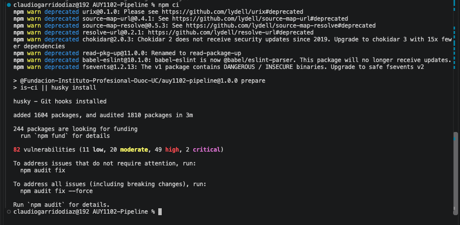

## 5. Pruebas unitarias y cobertura

### 5.1 Pruebas iniciales

Las pruebas se ejecutaron con:

```bash
npm run test:unit
```

El resultado fue satisfactorio:

- 10 suites aprobadas de 10.
- 18 pruebas aprobadas de 18.
- 0 pruebas fallidas.
- Tiempo aproximado: 24,873 segundos.

Durante la ejecución aparecieron mensajes controlados asociados a `api.example.com` y una advertencia por un proceso abierto. Estos mensajes no causaron fallos en las pruebas.

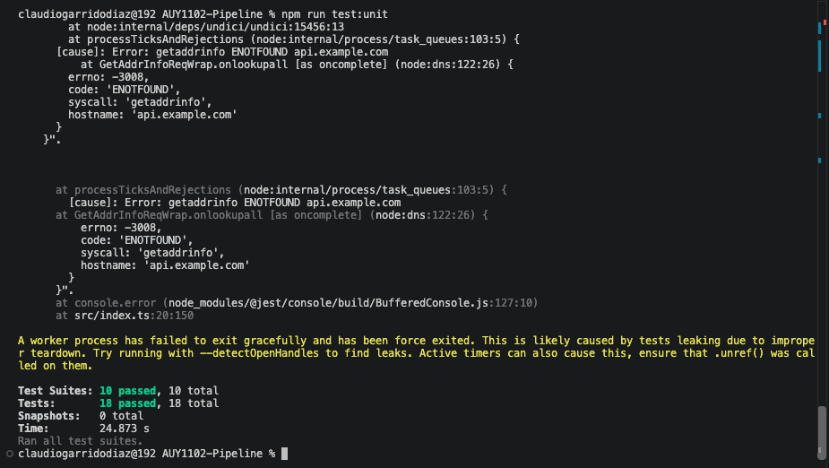

### 5.2 Cobertura inicial

La cobertura se generó con:

```bash
npm run test:coverage
```

Los resultados globales fueron:

| Métrica | Cobertura |
|---|---:|
| Sentencias | 39,18 % |
| Ramas | 60 % |
| Funciones | 53,12 % |
| Líneas | 39,18 % |

Se identificaron archivos con cobertura nula o baja dentro de `src/quality` y algunos objetos de valor. En contraste, varios archivos de `src/value-object` alcanzaron 100 %.

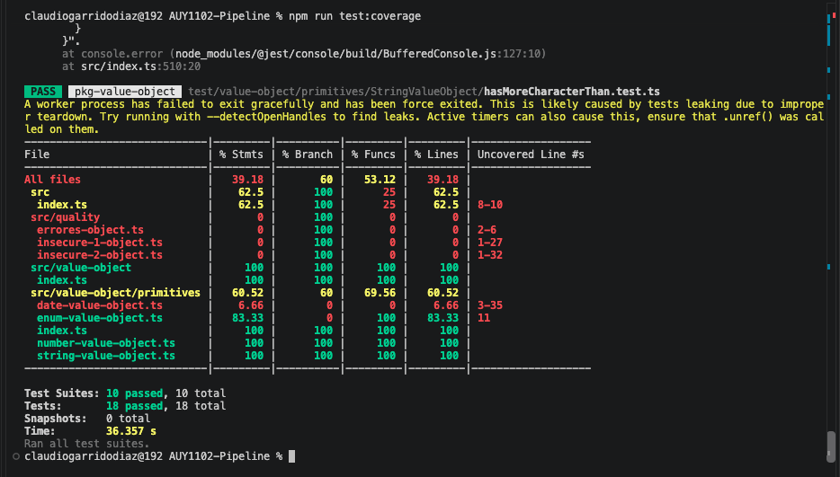

### 5.3 Informe HTML

Jest e Istanbul generaron un informe navegable en `coverage/lcov-report/index.html`. El informe permitió visualizar porcentajes por carpeta y localizar líneas no cubiertas.

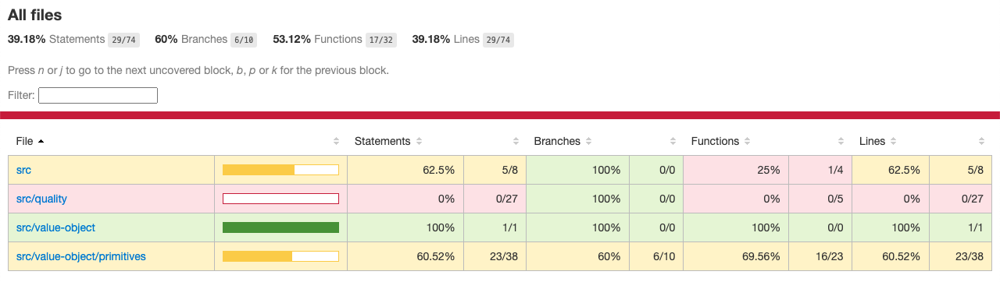

### 5.4 Exclusión del reporte generado

La carpeta `coverage/` contiene artefactos generados automáticamente. Se agregó a `.gitignore` para evitar subirla al repositorio. El cambio se registró con el commit `chore: ignorar reporte local de cobertura` y se publicó en `origin/master`.

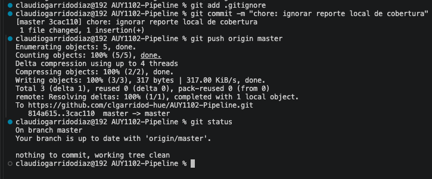

## 6. Análisis con SonarQube Cloud

### 6.1 Línea base

El fork público fue importado en SonarQube Cloud mediante la integración con GitHub. El primer análisis de `master` presentó:

- 16 problemas abiertos de seguridad.
- Calificación E en seguridad.
- 0 problemas de confiabilidad, calificación A.
- 1 problema de mantenibilidad, calificación A.
- 0,0 % de duplicación.
- 792 líneas de código.

La cobertura no apareció en el análisis automático porque el archivo `lcov.info` se generó localmente y no fue entregado por un flujo CI.

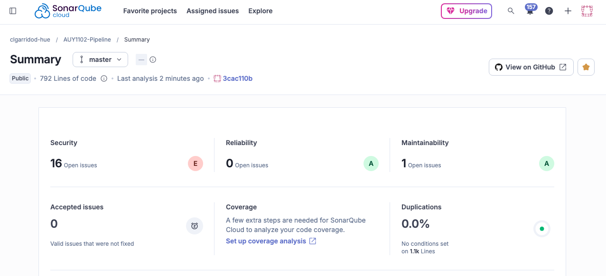

### 6.2 Hallazgos de seguridad

Los 16 problemas se distribuían en archivos de workflows, configuración, Docker y código fuente. Se seleccionó `src/quality/insecure-1-object.ts` porque presentaba un hallazgo corregible y directamente relacionado con el código de la aplicación.

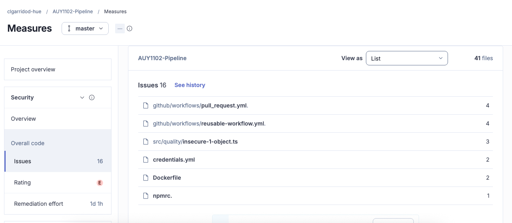

### 6.3 Vulnerabilidad seleccionada

El código obtenía `req.body.username`, lo insertaba dentro del texto de una plantilla Pug y posteriormente ejecutaba `pug.compile(template)`. Esto permitía que la entrada del usuario participara en la construcción de la plantilla, generando riesgo de Server-Side Template Injection.

Estructura vulnerable simplificada:

```javascript
const input = req.body.username;
const template = `p Hello ${input}`;
const fn = pug.compile(template);
```

### 6.4 Remediación aplicada

La plantilla se dejó estática, se compiló una sola vez y el valor externo se entregó como dato:

```javascript
const template = `
p Hello #{username}
`;

const renderTemplate = pug.compile(template);

app.post('/', (req, res) => {
  const input = String(req.body.username ?? '');
  const html = renderTemplate({ username: input });
  res.send(html);
});
```

La corrección evita que la entrada del usuario forme parte del código de la plantilla. Pug trata `username` como un dato e interpola el contenido de manera escapada.

Después del cambio se ejecutaron nuevamente las 10 suites y 18 pruebas, todas aprobadas. El archivo corregido también fue revisado individualmente con ESLint. El lint global conservó problemas preexistentes en `src/index.ts`, pero no informó errores nuevos en el archivo remediado.

La corrección se publicó con el commit `7d6163d`, cuyo mensaje fue `fix: prevenir inyeccion de plantilla en Pug`.

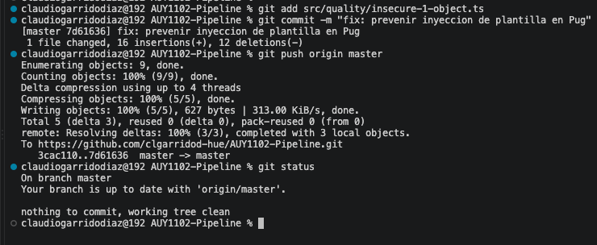

### 6.5 Verificación posterior

El nuevo análisis de SonarQube Cloud redujo los problemas de seguridad de 16 a 15. Esto confirmó la desaparición del hallazgo seleccionado. La nota global permaneció en E debido a los otros problemas deliberadamente presentes en el repositorio.

| Estado | Problemas de seguridad |
|---|---:|
| Antes | 16 |
| Después | 15 |
| Diferencia | 1 problema corregido |

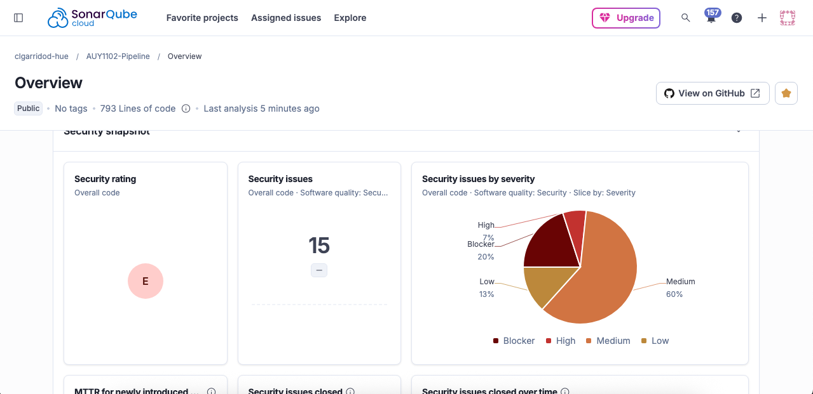

## 7. Análisis con Snyk

### 7.1 Resultado de Snyk Open Source

El repositorio fue vinculado con Snyk mediante GitHub. El análisis principal de `package.json` detectó:

- 7 vulnerabilidades totales.
- 4 de severidad alta.
- 3 de severidad media.
- 0 críticas.
- 0 bajas.
- 6 problemas con corrección disponible.
- 1 problema sin una corrección compatible informada.

Las vulnerabilidades aparecieron agrupadas bajo `chokidar@2.0.3`, una dependencia con problemas transitivos. La actualización sugerida a `chokidar@3.0.0` fue identificada como un cambio mayor.

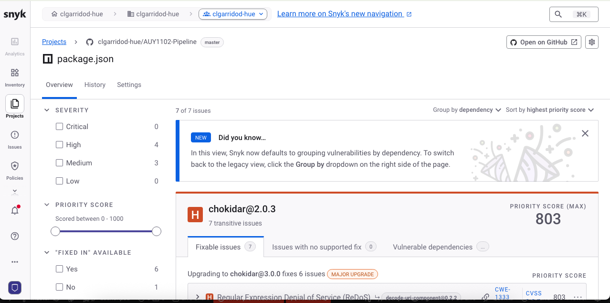

### 7.2 Hallazgo representativo

Se revisó un problema Regular Expression Denial of Service, ReDoS, con los siguientes datos:

- Severidad: alta.
- CVSS: 8.2.
- CWE-1333.
- Snyk ID: `SNYK-JS-DECODEURICOMPONENT-21802484`.
- Dependencia vulnerable: `decode-uri-component@0.2.2`.
- Introducida mediante: `chokidar@2.0.3`.
- Versión corregida de la dependencia afectada: `decode-uri-component@0.5.1`.
- Madurez del exploit: Proof of Concept.
- Puntaje de prioridad: 803.

La vulnerabilidad era transitiva, por lo que el proyecto no dependía directamente de `decode-uri-component`. No se aplicó automáticamente la actualización principal sugerida porque podía introducir incompatibilidades.

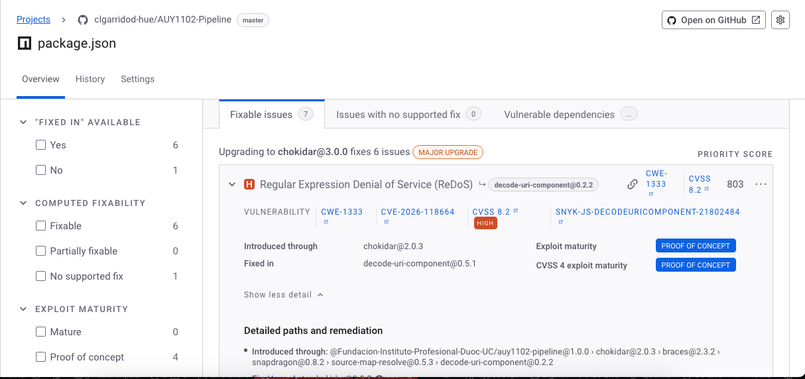

Snyk detectó además proyectos para `Dockerfile` y archivos compatibles con Snyk Code. La evidencia se concentró en Snyk Open Source, donde se obtuvieron resultados completos de las dependencias del proyecto.

## 8. Análisis con npm audit

Se ejecutó:

```bash
npm audit
```

El resultado fue:

| Severidad | Cantidad |
|---|---:|
| Crítica | 2 |
| Alta | 49 |
| Moderada | 20 |
| Baja | 11 |
| **Total** | **82** |

Entre los avisos visibles se encontraron problemas en `tmp`, `external-editor`, `yaml` y `lint-staged`. npm ofreció `npm audit fix` y `npm audit fix --force`. No se aplicó `--force`, debido a que npm indicó cambios incompatibles, incluida la instalación de una versión mayor de `eslint-config-node`.

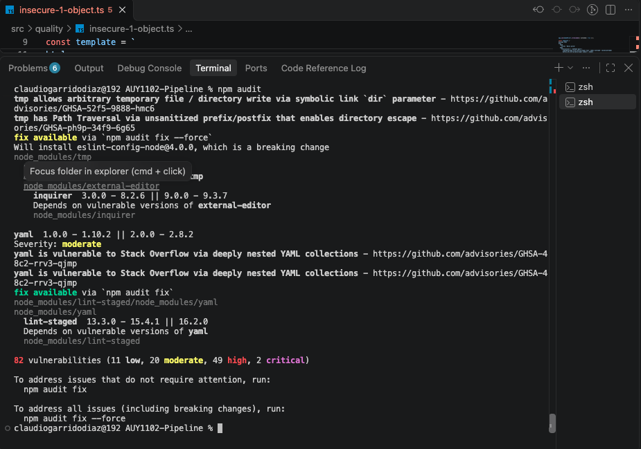

Las 82 vulnerabilidades de npm no se comparan de forma directa con los 7 problemas de Snyk. npm audit enumera avisos a través del árbol de dependencias, mientras que Snyk agrupa vulnerabilidades por dependencia y ruta de introducción. SonarQube Cloud, por otra parte, analiza principalmente el código y archivos de configuración.

## 9. Seguridad de GitHub

Se revisaron y configuraron las funciones de seguridad disponibles en el repositorio, incluyendo Dependency Graph, Dependabot Alerts, Dependabot Security Updates y las opciones de detección de secretos disponibles para el repositorio público.

No se aplicaron correcciones automáticas masivas ni pull requests de actualización durante esta etapa. La decisión se tomó para evitar cambios mayores sin una validación individual de compatibilidad y pruebas.

## 10. Resumen de resultados

| Área | Resultado |
|---|---|
| Pruebas unitarias | 10 suites y 18 pruebas aprobadas |
| Cobertura de líneas | 39,18 % |
| Cobertura de ramas | 60 % |
| Cobertura de funciones | 53,12 % |
| SonarQube inicial | 16 problemas de seguridad |
| SonarQube final | 15 problemas de seguridad |
| Remediación | SSTI en Pug corregida |
| Snyk Open Source | 7 vulnerabilidades: 4 altas y 3 medias |
| npm audit | 82 vulnerabilidades: 2 críticas, 49 altas, 20 moderadas y 11 bajas |

## 11. Conclusiones

La evaluación permitió aplicar un ciclo completo de revisión de calidad y seguridad sobre un proyecto real: preparación del entorno, ejecución de pruebas, medición de cobertura, análisis con múltiples herramientas, selección de un hallazgo y verificación posterior de la corrección.

Las pruebas existentes entregaron una base funcional estable, pero la cobertura global de 39,18 % evidencia que una parte importante del código no está protegida por pruebas. Una mejora posterior debería incorporar casos para `src/quality` y para los objetos de valor con cobertura baja.

SonarQube Cloud permitió identificar una inyección de plantilla del lado del servidor. La corrección separó la plantilla estática de los datos externos y redujo el total de problemas de 16 a 15 sin romper las 18 pruebas existentes.

Snyk y npm audit mostraron una deuda relevante en dependencias antiguas. Debido a que varias soluciones requerían actualizaciones mayores, la estrategia más segura sería actualizar dependencias de manera gradual, ejecutar pruebas después de cada cambio y evitar `npm audit fix --force` sin revisión.

En conclusión, el repositorio quedó publicado, analizado y con una vulnerabilidad de código corregida y demostrada mediante evidencia antes y después.


