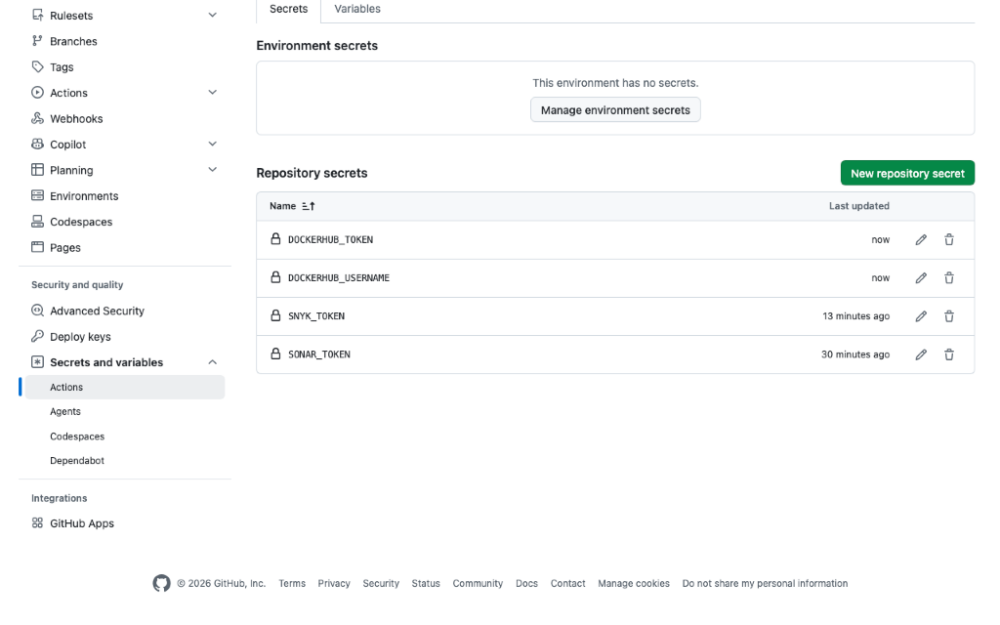
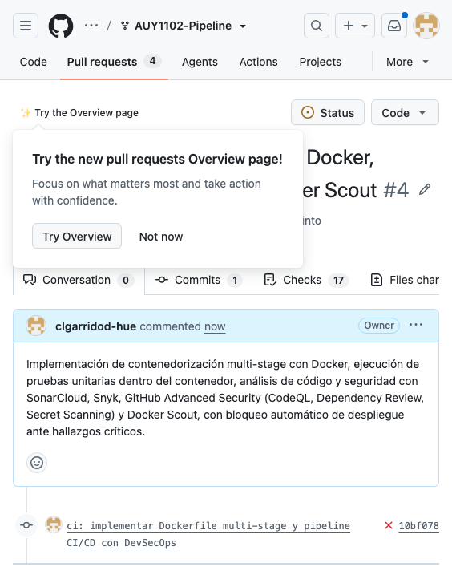
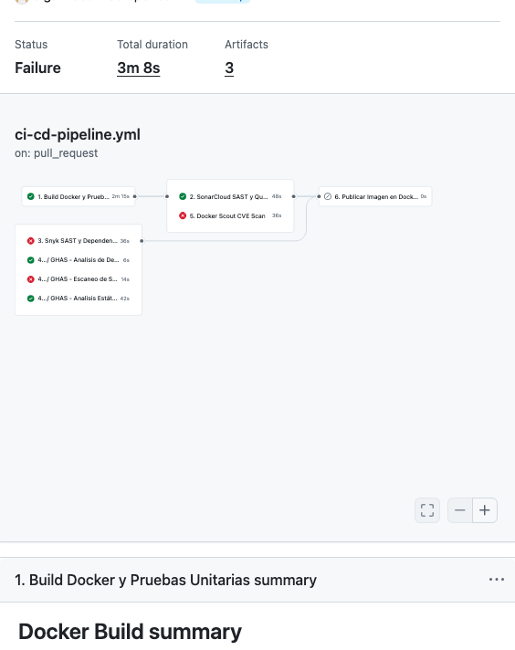
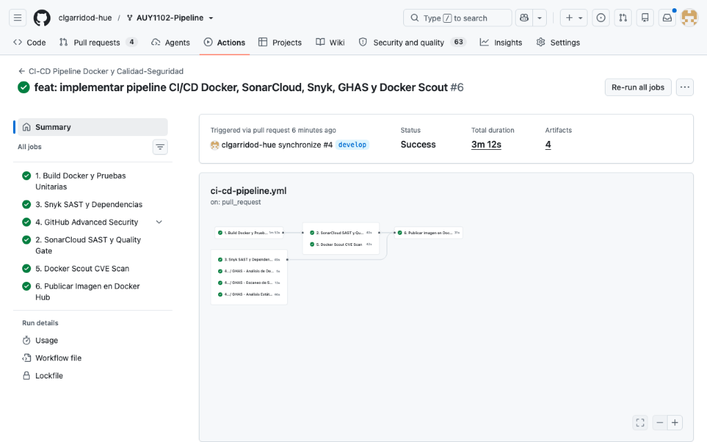
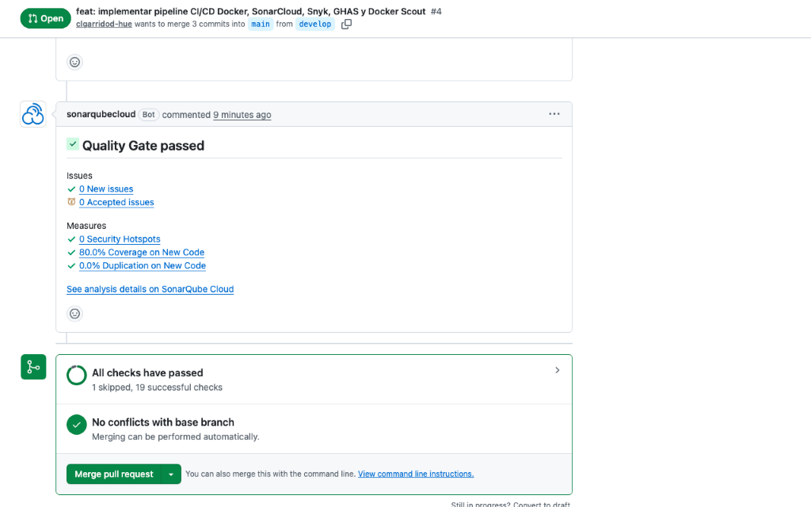
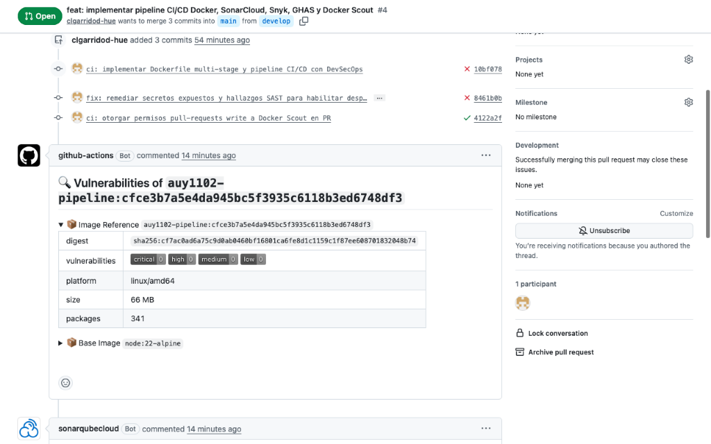
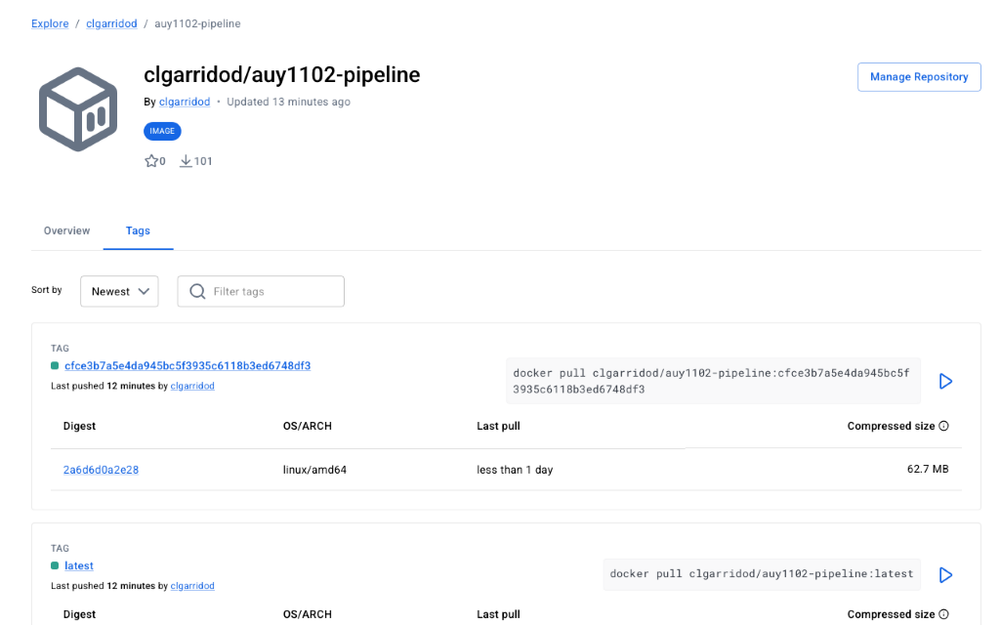

# Informe de Evaluación Parcial N° 3 — AUY1102

## Aseguramiento de la Calidad del Software y Pipeline CI/CD con GitHub Actions y Docker

**Estudiante:** Claudio Garrido D.  
**Asignatura:** Ciclo de Vida del Software I (`AUY1102`)  
**Modalidad de ejecución:** Individual  
**Repositorio base:** [Fundacion-Instituto-Profesional-Duoc-UC/AUY1102-Pipeline](https://github.com/Fundacion-Instituto-Profesional-Duoc-UC/AUY1102-Pipeline)  
**Fork implementado (Público):** [clgarridod-hue/AUY1102-Pipeline](https://github.com/clgarridod-hue/AUY1102-Pipeline)  
**Pull Request de validación (`develop` → `main`):** [PR #4 — Implementar pipeline CI/CD Docker, SonarCloud, Snyk, GHAS y Docker Scout](https://github.com/clgarridod-hue/AUY1102-Pipeline/pull/4)  
**Imagen publicada en Docker Hub:** [clgarridod/auy1102-pipeline](https://hub.docker.com/r/clgarridod/auy1102-pipeline)  

---

## 1. Introducción

El objetivo de esta evaluación fue diseñar, implementar y validar de manera individual un pipeline automatizado de Integración y Entrega Continua (**CI/CD**) con enfoque **DevSecOps** sobre una aplicación Node.js/TypeScript alojada en mi fork público de GitHub (`clgarridod-hue/AUY1102-Pipeline`), conservando intacta la rama `master` histórica de la evaluación previa.

La solución integra la contenedorización multi-etapa con **Docker**, la ejecución automatizada de **pruebas unitarias y cobertura dentro del contenedor**, el análisis continuo de código y seguridad mediante **SonarQube Cloud (SonarCloud)**, **Snyk (Snyk Code SAST y Snyk Open Source SCA)**, **GitHub Advanced Security** (*Dependency Review*, *Secret Scanning* con reporte SARIF y *CodeQL*) y **Docker Scout**, condicionando estrictamente la publicación de la imagen en **Docker Hub** a la ausencia de fallos en pruebas o hallazgos críticos de calidad y seguridad.

---

## 2. Arquitectura y Diseño del Flujo CI/CD

### 2.1 Estrategia de ramas y disparadores

Para cumplir con las prácticas de desarrollo ágil y los requerimientos de la evaluación sin alterar el respaldo previo en `master`, se estructuró el flujo sobre dos ramas operativas:

- **`develop`**: rama de integración continua donde cada evento `push` dispara automáticamente la construcción del contenedor, la ejecución de pruebas unitarias aisladas, los escaneos de seguridad y el despliegue condicionado.
- **`main`**: rama principal de entrega hacia la cual se abren **Pull Requests** desde `develop`, activando la totalidad de las compuertas de análisis estático y revisión de dependencias antes de autorizar el despliegue.

### 2.2 Gestión ética y segura de credenciales

Respetando los principios de integridad del código y seguridad operacional, ninguna credencial real fue almacenada en archivos del repositorio. Todas las integraciones externas se autenticaron exclusivamente mediante **GitHub Actions Encrypted Secrets**:

- `DOCKERHUB_USERNAME` y `DOCKERHUB_TOKEN` (Personal Access Token con permisos acotados para Docker Hub y Docker Scout).
- `SONAR_TOKEN` (token de autenticación para SonarQube Cloud con *Automatic Analysis* desactivado en favor del análisis por CI).
- `SNYK_TOKEN` (token de API para análisis SAST y SCA en la organización `clgarridod-hue`).



Adicionalmente, todos los *actions* utilizados en `.github/workflows/` fueron fijados mediante su **commit SHA inmutable de 40 caracteres** y configurados con bloques explícitos de permisos de mínimo privilegio (`permissions: contents: read`), previniendo ataques a la cadena de suministro.

---

## 3. Parte 1: Automatización con GitHub Actions y Docker

### 3.1 Contenedorización Multi-Stage (`Dockerfile` y `.dockerignore`)

El `Dockerfile` original del repositorio base utilizaba una imagen obsoleta (`node:14-alpine3.16`), copiaba todo el contexto en `/` sin exclusiones y se ejecutaba como `root`. Para resolver estas deficiencias se diseñó un **`Dockerfile` multi-stage** acompañado de un archivo **`.dockerignore`**:

1. **Etapa `test` (`FROM node:22-alpine AS test`)**:
   - Actualiza los paquetes del sistema operativo base (`apk --no-cache upgrade`) para mitigar vulnerabilidades a nivel de imagen.
   - Instala las dependencias de forma determinista con `npm ci --ignore-scripts` (previniendo la ejecución arbitraria de scripts durante la construcción).
   - Copia únicamente los archivos de configuración, `src/` y `test/`, asignando permisos al usuario sin privilegios `USER node`.
   - Ejecuta las **pruebas unitarias y medición de cobertura dentro del contenedor**.
2. **Etapa `production` (`FROM node:22-alpine AS production`)**:
   - Instala únicamente dependencias de producción (`npm ci --omit=dev --ignore-scripts`) y limpia la caché de `npm`.
   - Opera bajo `ENV NODE_ENV=production` y usuario sin privilegios `USER node`, logrando una imagen final liviana (~62 MB) libre de herramientas de desarrollo e historial Git.

### 3.2 Automatización en `.github/workflows/ci-cd-pipeline.yml`

El job **`1. Build Docker y Pruebas Unitarias`** automatiza en cada `push` a `develop` y `pull_request` a `main`:

1. Construcción de la etapa `test` con `docker/build-push-action` (`target: test`, `load: true`).
2. Ejecución de la suite completa de Jest **dentro del contenedor** mediante:
   ```bash
   docker run --rm auy1102-pipeline:test npm run test:unit -- --forceExit
   ```
3. Generación y extracción del reporte `coverage/lcov.info` desde el contenedor hacia un artefacto del pipeline para alimentar la evaluación de cobertura en SonarCloud.

---

## 4. Parte 2: Análisis de Código, Seguridad y Compuerta de Bloqueo

El pipeline integra cuatro capas complementarias de aseguramiento de calidad y seguridad en paralelo y secuencia antes de autorizar cualquier publicación:

| Componente | Workflow / Job | Función en el Pipeline | Criterio de Bloqueo |
|---|---|---|---|
| **SonarQube Cloud** | `2. SonarCloud SAST y Quality Gate` | Análisis estático de código, cobertura y *Security Hotspots* en cada PR a `main` (`-Dsonar.qualitygate.wait=true`). | Falla si el *Quality Gate* no aprueba (calificación peor que `A` o cobertura `< 80%` en código nuevo). |
| **Snyk** | `3. Snyk SAST y Dependencias` | Análisis estático de código (`snyk code test`) y dependencias (`snyk test`). | Falla ante vulnerabilidades SAST de severidad alta (`high`) o dependencias críticas (`critical`). |
| **GitHub Advanced Security** | `4. GitHub Advanced Security` (`ghas-security.yml`) | *Workflow* reutilizable con **Dependency Review**, **Secret Scanning** (Gitleaks + subida SARIF a GHAS) y **CodeQL SAST**. | Falla si se introducen dependencias críticas, errores CodeQL o secretos expuestos en el repositorio. |
| **Docker Scout** | `5. Docker Scout CVE Scan` | Escaneo de CVEs sobre la imagen candidata de producción (`local://auy1102-pipeline:<sha>`). | Falla (`exit-code: true`) si se detectan vulnerabilidades críticas (`only-severities: critical`). |

El job final **`6. Publicar Imagen en Docker Hub`** declara `needs:` sobre todos los jobs anteriores, garantizando por diseño que cualquier fallo en pruebas unitarias, calidad o seguridad **interrumpa automáticamente el despliegue**.

---

## 5. Validación Experimental en Dos Fases

### 5.1 Fase A (Corrida 1): Verificación de Bloqueo Automático ante Hallazgos Críticos

En la primera ejecución se abrió el **Pull Request #4 (`develop` → `main`)** conservando deliberadamente los secretos de prueba y hallazgos de código heredados del repositorio base, con el objetivo de comprobar empíricamente que el pipeline bloqueara la publicación.



En el run `45833869318`, las pruebas unitarias dentro del contenedor aprobaron satisfactoriamente (10 suites, 18 pruebas aprobadas), pero las compuertas de seguridad detectaron los problemas existentes e interrumpieron el pipeline:

- **Snyk Code (SAST)** detectó **2 vulnerabilidades de severidad Alta (`HIGH`)**:
  1. *Hardcoded Non-Cryptographic Secret* en `src/index.ts` (línea 3).
  2. *Cross-site Scripting (XSS)* en `src/quality/insecure-1-object.ts` (línea 27, uso directo de `res.send(html)`).
- **GHAS — Escaneo de Secretos** detectó **5 credenciales expuestas** en `.npmrc` (`github-pat`), `credentials.yml` (`github-fine-grained-pat`) y `src/index.ts` (`generic-api-key`), publicando el reporte SARIF en la pestaña *Security* de GitHub y devolviendo código de error `1`.
- Como consecuencia directa, el job **`6. Publicar Imagen en Docker Hub` fue cancelado/omitido (`skipped`)**, impidiendo la publicación de una imagen comprometida.



---

### 5.2 Fase B (Corrida 2): Remediación y Despliegue Exitoso en Docker Hub

Una vez demostrada la efectividad del bloqueo, se aplicaron las remediaciones correspondientes en la rama `develop`:

1. **Eliminación de secretos expuestos**:
   - Se eliminó el archivo `credentials.yml` del control de versiones.
   - Se parametrizó `.npmrc` reemplazando el token fijo por la variable de entorno `${NPM_TOKEN}`.
   - Se removieron las credenciales estáticas (`apiKey`, `githubToken`) y llamadas laterales en `src/index.ts`, exponiendo una función pura cubierta con pruebas unitarias en `test/index.test.ts` (elevando el total a **11 suites y 20 pruebas unitarias aprobadas**).
2. **Mitigación de XSS en SAST (`src/quality/insecure-1-object.ts`)**:
   - Se reemplazó el envío directo de HTML sin sanitización reconocida (`res.send(html)`) por una respuesta estructurada JSON (`res.json(...)`), eliminando el vector de *Cross-site Scripting* reportado por Snyk Code.
3. **Permisos de reporte para Docker Scout en Pull Requests**:
   - Se otorgaron permisos acotados (`pull-requests: write`, `issues: write`) exclusivamente al job `docker-scout-scan` para permitir la publicación automática del resumen de CVEs en el Pull Request.

Al ejecutar la **Corrida 2**, la totalidad de los controles finalizaron en estado **`success`**:

- **Docker Build y Pruebas Unitarias**: 11 suites y 20 pruebas ejecutadas exitosamente dentro del contenedor.
- **SonarQube Cloud Quality Gate (`Passed`)**: Calificación **A** en Seguridad, **A** en Confiabilidad, **A** en Mantenibilidad, **80,0 %** de cobertura sobre código nuevo, **0,0 %** de duplicación y **100 %** en *Security Hotspots*.
- **Snyk Code y Snyk Open Source**: **0** vulnerabilidades críticas o altas abiertas.
- **GitHub Advanced Security**: *Dependency Review* aprobado, **0** secretos expuestos y análisis *CodeQL* limpio.
- **Docker Scout**: **0** vulnerabilidades críticas, altas, medias o bajas (`critical: 0, high: 0, medium: 0, low: 0`) detectadas sobre los **341 paquetes** indexados de la imagen `node:22-alpine` (`62,7 MB` comprimida).
- **Publicación en Docker Hub**: Imagen construida y publicada exitosamente en `clgarridod/auy1102-pipeline:latest` y etiquetada por SHA inmutable.









---

## 6. Resumen Comparativo de Resultados

| Etapa / Verificación | Corrida 1 (Con vulnerabilidades base) | Corrida 2 (Post-remediación) |
|---|---|---|
| Construcción Docker (`node:22-alpine` multi-stage) | Exitosa | Exitosa |
| Pruebas unitarias dentro del contenedor | 10 suites / 18 pruebas aprobadas | 11 suites / 20 pruebas aprobadas |
| SonarQube Cloud (*Quality Gate* en PR a `main`) | Aprobado (`A / A / A`) | Aprobado (`A / A / A`, 80 % cobertura nueva) |
| Snyk Code (SAST) + Snyk Open Source (SCA) | **Bloqueado** (2 hallazgos `HIGH`: Secreto y XSS) | **Aprobado** (0 hallazgos críticos/altos) |
| GHAS (*Dependency Review*, *Secret Scan*, *CodeQL*) | **Bloqueado** (5 secretos detectados en 3 archivos) | **Aprobado** (0 secretos, 0 deps críticas) |
| Docker Scout (Escaneo de CVEs críticos en imagen) | **Bloqueado** | **Aprobado** (0 CVEs críticos) |
| Publicación en Docker Hub (`clgarridod/auy1102-pipeline`) | **Interrumpida (`skipped`)** | **Publicada (`:latest` y `:<sha>`)** |

---

## 7. Conclusiones

La implementación desarrollada demuestra en la práctica cómo la integración coordinada de contenedores Docker y herramientas automatizadas de análisis estático, composición de software y escaneo de contenedores dentro de **GitHub Actions** permite resguardar de forma efectiva la calidad y seguridad del ciclo de vida del software.

Mediante una arquitectura multi-etapa en Docker se garantizó que las pruebas unitarias se ejecuten exactamente en el mismo entorno aislado de construcción antes de empaquetar una imagen de producción minimalista y sin privilegios de superusuario. Asimismo, la combinación de **SonarQube Cloud**, **Snyk**, **GitHub Advanced Security** y **Docker Scout** demostró ser complementaria: mientras Gitleaks/GHAS y Snyk Code bloquearon oportunamente credenciales expuestas y riesgos de XSS en código fuente en la primera corrida, SonarCloud validó la mantenibilidad, cobertura de pruebas y buenas prácticas de infraestructura como código, y Docker Scout certificó la ausencia de vulnerabilidades críticas en las capas del contenedor antes de su publicación final en Docker Hub.
